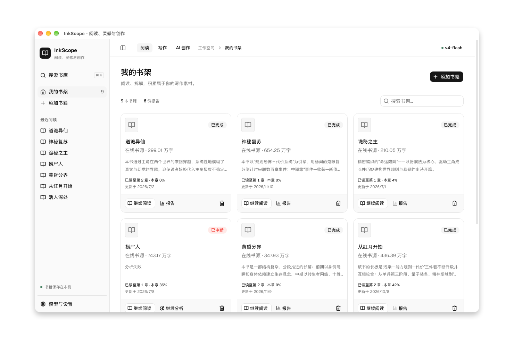
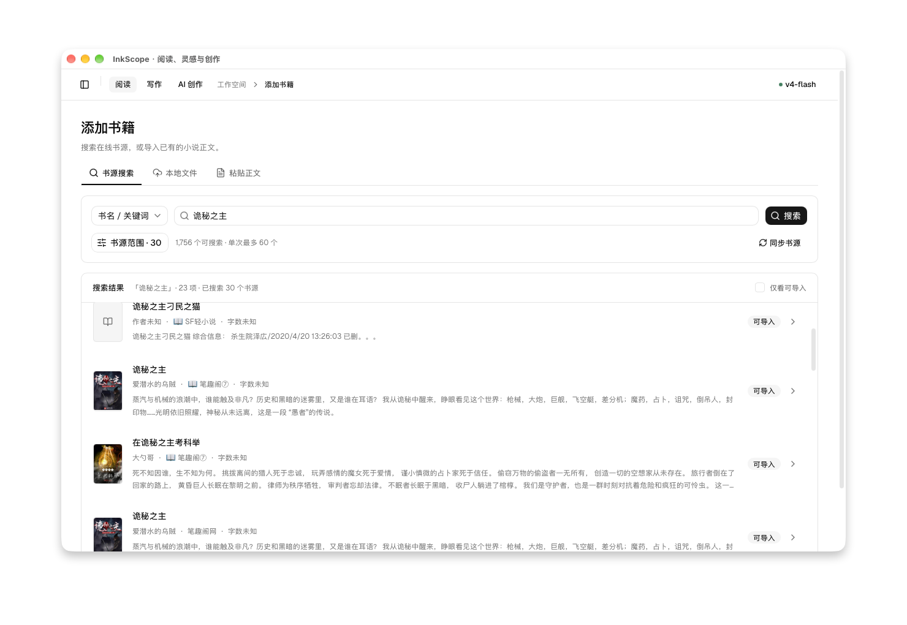
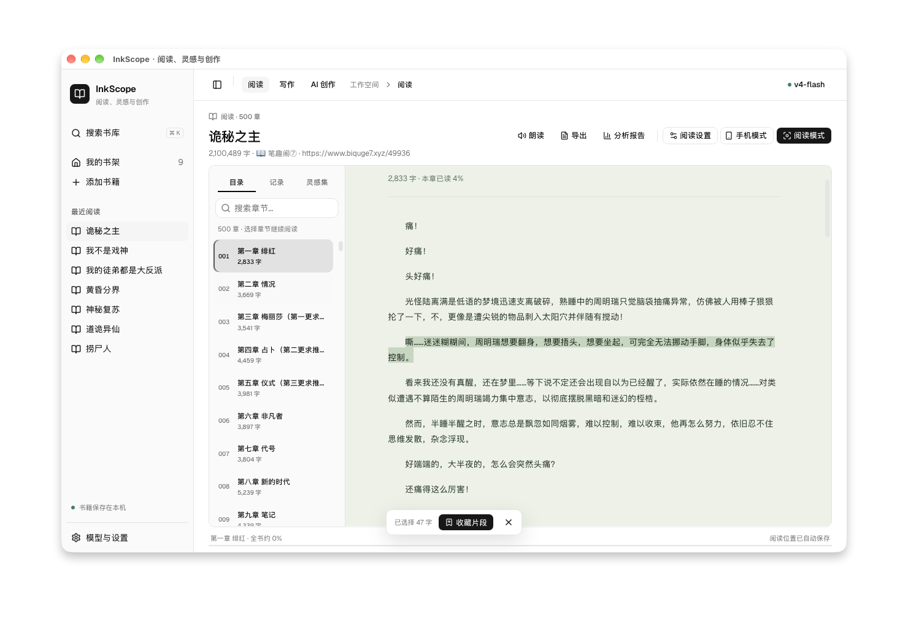
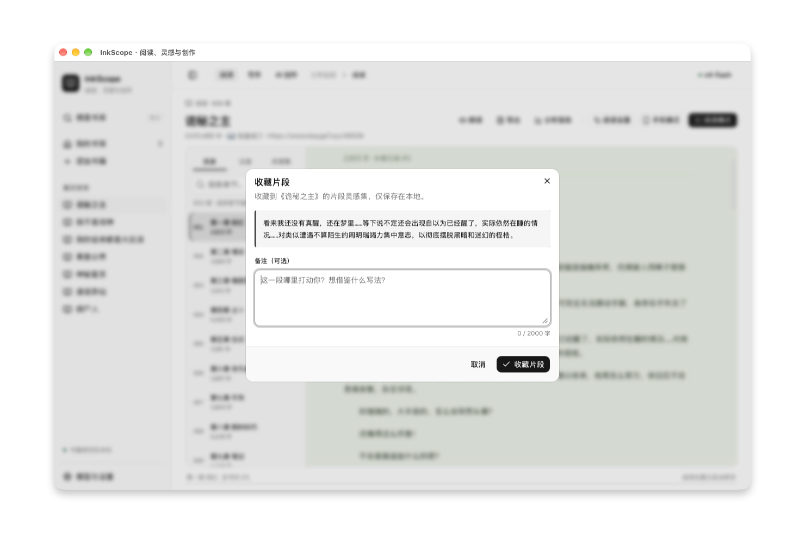
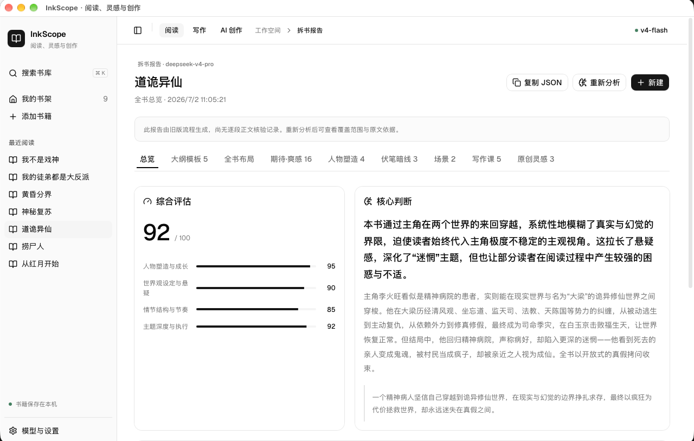

<div align="center">

# InkScope

### 阅读，理解写法，完成自己的故事。

面向小说作者的本地阅读与创作工作台

[下载应用](https://github.com/BeginnerDone/inkscope/releases) · [使用说明](docs/usage.md) · [更新日志](CHANGELOG.md) · [问题反馈](https://github.com/BeginnerDone/inkscope/issues)

</div>

<br />



<p align="center"><sub>本地运行实拍 · 书架、阅读进度与拆书报告统一管理</sub></p>

## 关于 InkScope

InkScope 为小说作者提供一个连接阅读积累、写法研究和长篇创作的桌面工作空间。从书架中的一本书，到值得收藏的片段，再到自己的设定、大纲与章节，让阅读所得逐步进入写作。

你可以独立使用阅读器和手动写作，也可以配置 DeepSeek，按需使用拆书分析、章节规划、审稿与修订。书籍、稿件和工作记录保存在本机，AI 内容由作者预览、确认后采用。

## 核心功能

| 阅读与积累 | 写法与结构研究 | 小说创作 |
| :--- | :--- | :--- |
| 本地文件导入与第三方书源搜索 | 基于已保存正文进行 AI 审读 | 分卷、章节、设定与大纲管理 |
| 阅读进度、主题与排版设置 | 分析结构、人物、伏笔和情绪兑现 | 手动写作、伏笔关联与回收 |
| 片段收藏、备注与章节定位 | 展示审读覆盖与引文核对状态 | AI 起草、续写、审稿与修订 |
| 专注阅读、窄屏模式与朗读 | 整理写作方法和原创构思 | 自动保存、历史版本与导出 |

## 真实界面

以下截图直接来自本机运行的 InkScope，展示实际书库与已生成的分析结果。报告内容由 AI 生成，仅作为写作研究参考。

### 搜索书源，添加想读的作品

按书名、关键词或作者搜索第三方书源，查看结果并筛选可导入的作品，也可通过本地文件或粘贴正文添加书籍。



<p align="center"><sub>本地运行实拍 · 书源范围选择、搜索结果与可导入筛选</sub></p>

### 在阅读中积累片段灵感

通过章节目录继续阅读，自定义阅读主题与排版，自动保存阅读位置。遇到值得学习的描写、对白或情节，可以直接划选正文，收藏到当前书籍的灵感集中。



<p align="center"><sub>本地运行实拍 · 章节目录、护眼主题与正文划选收藏</sub></p>

收藏时可添加备注，记录这段文字打动你的原因或想借鉴的写法。片段与备注保存在本地，后续可在灵感集中查看、修改备注，并返回原章节定位。



<p align="center"><sub>本地运行实拍 · 收藏原文片段，并记录自己的写作观察</sub></p>

### 把分析落实到结构与写法

报告围绕全书布局、人物、伏笔暗线、场景和情绪推进展开，并保留正文审读范围与待复核提示，方便回看分析依据。



<p align="center"><sub>本地运行实拍 · 报告总览、结构分析入口与正文审读记录</sub></p>

### 从故事准备走到章节定稿

写作空间用于日常正文编辑、设定管理与伏笔记录；AI 创作提供故事准备、章节规划、草稿、审稿、修订和定稿流程。两种空间共用作品数据，可根据写作阶段切换。

## 开始使用

### 1. 安装应用

在 [Releases](https://github.com/BeginnerDone/inkscope/releases) 中选择对应系统的安装包。仓库提供 macOS、Windows 与 Linux 构建流程，实际可下载文件以版本附件为准。

### 2. 添加书籍或创建作品

- **开始阅读**：导入 TXT / Markdown 文件，或搜索第三方书源并下载到本地书架。
- **开始写作**：创建作品或导入自己的稿件，在「写作」中整理分卷和章节。
- **使用 AI**：在「模型与设置」中填写 DeepSeek API 配置，再使用拆书分析或创作协作。

阅读、片段收藏和手动写作不依赖 AI。AI 分析和生成需要网络及有效的模型服务配置。

### 3. 按章节推进创作

```text
故事准备 → 本章规划 → 草稿 → 审稿 → 修订 → 定稿
                                            ↓
                                  确认章节记录，继续下一章
```

候选正文先预览再采用；审稿意见与章节记录由作者确认。定稿后需要改动时，可创建修订版并保留原有快照。

详细操作、朗读设置、分析范围与保存机制见 [使用说明](docs/usage.md)。

## 数据与使用边界

| 项目 | 说明 |
| :--- | :--- |
| 本地保存 | 阅读书库按书独立保存；创作稿件、历史版本及工作记录保存在本机 SQLite 中。 |
| AI 数据范围 | 使用 AI 时，本次任务相关的正文和资料会发送至配置的模型服务；单次创作请求仅使用有限上下文。 |
| 在线朗读 | 在线声音会将当前朗读片段发送给所选服务；系统语音由设备提供。 |
| 分析完整性 | 书源书籍需完成当前目录下载后分析；本地文件是否为全本由使用者确认。引文无法核对时会标为待复核。 |
| 作者决定 | 分析结论、原创方案和生成正文均需人工判断，不保证理解无遗漏或市场表现。 |

macOS 默认数据目录：

```text
~/Library/Application Support/com.inkscope.storylab/
```

## 开发指南

技术栈：React · TypeScript · Tauri 2 · Rust · SQLite。

需要 Node.js、npm、Rust stable，以及所在操作系统的 Tauri 2 系统依赖。CI 使用 Node.js 22。

```bash
npm install
npm run tauri
```

仅预览前端界面：

```bash
npm run dev
```

前端预览无法使用 SQLite、书源抓取和模型分析等桌面能力；完整功能需在 Tauri 客户端中运行。

### 检查与构建

```bash
# 前端类型检查与构建
npm run build

# 界面测试（演示数据）
npx playwright install chromium
npm run test:ui

# 当前操作系统的桌面安装包
npm run tauri:build

# Rust 测试
cd src-tauri
cargo test
```

桌面包需在对应操作系统构建。推送 `v*` tag，或手动运行 [Build desktop packages](https://github.com/BeginnerDone/inkscope/actions/workflows/build-desktop.yml)，可构建 macOS、Windows 和 Linux 安装包。


### 版本发布

```bash
# 预览下一次发布
npm run release -- patch --dry-run

# 创建本地版本提交与标签
npm run release -- patch

# 创建并推送版本
npm run release:push -- patch
```

发布脚本同步版本号、生成更新日志，并创建 release commit 和 tag。推送 tag 后触发桌面包构建。

<details>
<summary>项目结构</summary>

```text
.
├── src/                  # React 前端
│   ├── App.tsx           # 页面导航与主界面状态
│   ├── ReaderView.tsx    # 阅读器、朗读入口与片段收藏
│   ├── lib/speech-engines.ts # 内置在线声音
│   ├── lib/use-reader-speech.ts # 朗读播放控制
│   ├── lib/tauri.ts      # 前端调用 Tauri command
│   ├── styles.css        # 亮色极简 UI
│   └── types.ts          # 报告和书籍类型
├── src-tauri/            # Tauri / Rust 后端
│   ├── src/lib.rs        # SQLite、任务、DeepSeek、导出
│   ├── src/legado.rs     # Legado 书源解析与抓取
│   ├── src/speech.rs     # 在线朗读音频请求与地址校验
│   └── tauri.conf.json
├── scripts/              # 开发与构建脚本
└── README.md
```

</details>

## 已知限制

- 第三方书源依赖其规则和服务可用性；需要登录、JavaScript 或特殊加密的规则可能无法使用。
- 在线朗读与模型服务由第三方提供，网络或接口变化可能影响可用性。
- 全书一致性审计、跨卷时间轴和自动人物状态表仍待扩展。
- 手机模式是桌面应用内的窄屏阅读视图，并非独立移动客户端。

## 参考与致谢

创作流程参考 [AI-Novel-Writer](https://github.com/EthanYoQ/AI-Novel-Writer)、[Vela](https://github.com/heider-x/vela) 与 [chinese-novelist-skill](https://github.com/PenglongHuang/chinese-novelist-skill) 的规划、章节协作和资料衔接方式。内置写作方法参考 `novel-chapter-review`；提示词源码位于 `src-tauri/src/prompts/creation/`。

## 反馈

欢迎通过 [Issues](https://github.com/BeginnerDone/inkscope/issues) 提交建议或问题。请说明应用版本、操作系统和复现步骤，并在截图或日志中移除 API Key 与私人稿件内容。

## 隐私与版权提示

InkScope 面向个人本地阅读和写作学习。请只导入你拥有合法阅读和私人分析权限的内容。不要把受版权保护的全文、报告或导出文件用于未授权传播。

书籍与稿件保存在本机。使用 AI 分析或创作辅助时，本次任务相关的正文与资料会发送至所配置的模型服务；使用在线朗读时，当前朗读片段会发送至所选声音服务。请在使用前确认相关内容适合提交至对应服务。

## 许可

本项目采用 [MIT License](LICENSE)。使用、修改或分发时，请保留版权声明与许可文本。该许可适用于项目代码，不授予第三方书籍、导入内容或其他受版权保护材料的使用权。
